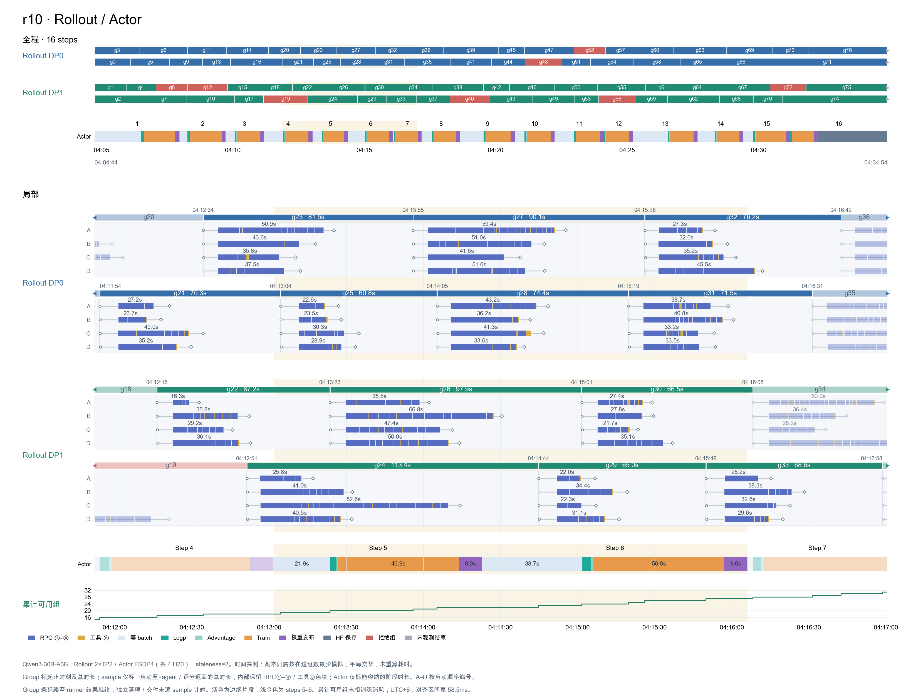
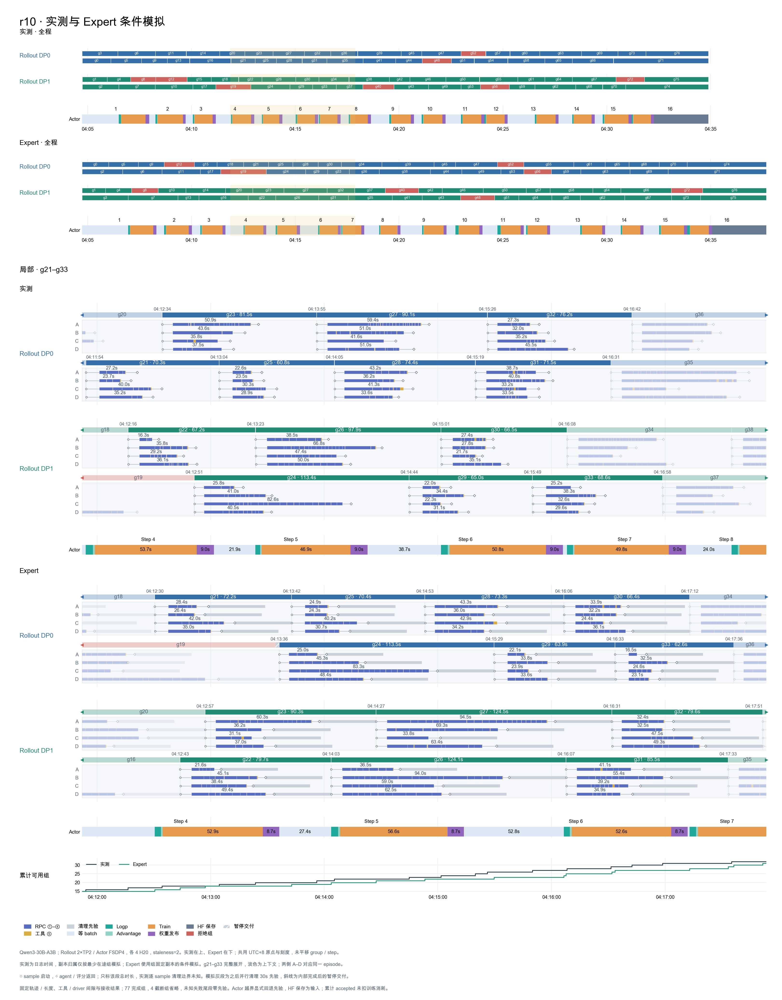

# Expert simulator／cost model 进度

更新：2026-10-21。[接口](README.md) · [模型设计](DESIGN.md) · [项目进度](../../../../../PROGRESS.md) ·
[公司端计划](../../../../../examples/autopilot/PLAN.md)

## 当前进度

- **整合**：[Milestone 清单](../../../../../examples/autopilot/elastic/milestones/preparation-20261021/README.md)
  保留 Expert `f11e3802` 的原始证据；Expert 已合入 Elastic 主线，模型与校准档案保持不变。新版 R10 入口统一维护， 旧常数基线通过显式
  legacy 参数复现；在线 Basic／revision 不依赖 Expert 实现。
  [组合验证](../../../../../examples/autopilot/elastic/validation/elastic-expert-integration-20261021.json)：634
  项 CPU 通过、1 项 CUDA 跳过， R10 新旧模式通过，严格未知步骤保持不评分；不替代 GPU 验收。

- **结果**：r10 条件模拟慢 **9.25%**；新增等 batch **136s** 中，前五个误差最大的更新步占 **67.1%**。多轮 RPC
  偏差及批次变化已分解，物理归因仍待观测。

- **已支持**：硬件／系统、模型、Actor／Rollout recipe 独立归档，`Catalog` 校验与组合；r10 数值输入、观测、校准与验证已沉淀到
  [trials/r10](trials/r10/manifest.json)。Actor 执行规则与 Rollout 服务／调度已抽取；249 项定向、329 项相关
  CPU 回归通过。

- **实验计划**：用户已确认
  [8×H20 的9个候选 trial](../../../../../examples/autopilot/swe-calibration/PLAN.md)（取消 H），
  每个24步、共216步；I 为2卡 Actor＋6卡 Rollout、每副本4槽／合计12槽。J 选
  `fsdp:d2c2`（DP2×CP2／Ulysses），配置／维度检查通过，真实训练／同步待验证；未启动训练。 跨 trial
  固定任务内容与逻辑输入顺序，按各自实际轨迹验收预测；输入清单／内容 hash 审计待接入。

- **固定到达 Actor 回放**：从 elastic 迁入
  [R10 入口](../../../../../examples/autopilot/elastic/README.md#r10-fixed-actor-replay)，Expert
  与回放源码／参数／输入独立冻结。 step 2–5 拟合结构化 advantage 的阶段倍率 1.7089，观察前 5 步后预测 6–16；同 8 步 WAPE
  41.97%→5.64%，全部后续 11 步为 4.56%。这与下方重建 Rollout 到达的条件模拟分别计分，不互相替代。
  [验证](../../../../../examples/autopilot/elastic/validation/r10-advantage-prefix-calibration-20261020.json)；logp／train
  的严格步骤 9／11／16 仍未覆盖；各组件速率仍为先验，跨配置精度未验。

- **后端／硬件接入**：固定到达回放已接 Megatron、Archon 与独立 H200 SXM／8-GPU 参考 profile；使用原 Expert 重新
  dispatch／packing，禁用源配置校准与误差评分。
  [CPU 合同验证](../../../../../examples/autopilot/elastic/validation/r10-backends-h200-20261020.json)覆盖显存下界、MP
  广播、缺失 auxiliary 和 Actor8 条件情景；无新增训练或目标精度结论。

- **权重发布建模**：新增完整 `update_weights` 组件模型，按 rank 准备／peer 流量／共享 host、fabric 与
  NIC／回填／控制边界计时， 已接 R10 回放及 simulator transition。R10 归档几何为 122.18 GB／79,520
  sends；速率仍为先验。 step 2–5 整段校准后，6–16 的 WAPE **3.45%**（raw **81.79%**），与旧常数基线相同，未证明跨配置精度。
  FSDP／Megatron 为 dense AWEX；Archon 仅旧式 XCCL bucket 近似，v2 adapter 仍缺。
  [验证](../../../../../examples/autopilot/elastic/validation/r10-publication-20261020.json)。

- **下一步**：补目标后端／硬件的阶段与发布／保存测量、校准和留出验证；验收 J、补齐对应 Expert
  与权重同步适配，完善真实路由／服务／清理观测后做跨配置校准与留出验证。 当前 simulator 覆盖不足不作为排除合法布局的理由；旧本地7项草案已被新计划替代。

- **基线冻结**：[源码／参数／输入快照](../../../../../../artifacts/qwen3-swe-trial-20261019/expert-workflow-baseline-20261019/manifest.json)已保存；30s／0s
  两方案[复跑逐事件一致](../../../../../../artifacts/qwen3-swe-trial-20261019/evidence/attempt-r10/expert-workflow/frozen-replay-verification/verification.json)，未重新拟合。

档案化与组件抽取的[等价验收](trials/r10/migration.json)已通过：16 步 raw／严格 Actor 预测一致，NumPy 1.26.4／2.5.4
中各自 30s／0s 两方案的 21,817 个保留事件及耗时一致，校准未重拟合。未知源码／NumPy 组合拒绝重用原校准。 全仓 pre-commit、wheel
数据完整性及脱离本地 artifacts 的装配检查通过。

开发快照：`feature/expert-cost-simulator`；档案／组件 `ab3a4d5b`，固定到达回放／校准 `cc457948`；后端与 H200 接入及
319 项相关 CPU 验证已完成。Expert 为固定参考模型，不含 optimizer；跨配置精度、公司端 v1/v2 兼容仍待验证。

## AReaL 2.0 workflow timeline

当前认知适用本仓库 v2 的 r10 异步 GRPO，更新于 2026-10-19。

| 侧       | 阶段                | Expert 表达／实测边界                                |
| -------- | ------------------- | ---------------------------------------------------- |
| Rollout  | ① 请求排队          | 副本、请求槽和 KV 容量限制；实测只见①–④合计 RPC      |
| Rollout  | ② Prefill           | 输入 tokens 服务量；实测未单独分离                   |
| Rollout  | ③ Decode            | 逐迭代生成；实测未单独分离                           |
| Rollout  | ④ RPC 响应延迟      | 服务后的异步交付 tail；属于拟合假设                  |
| Rollout  | ⑤ 工具／环境等待    | 输入已记录的外部区间，尚未覆盖全部环境成本           |
| Actor    | ⑥ recompute_logp    | 工作量／packing 模型；有 host 阶段计时               |
| Actor    | ⑦ compute_advantage | 组件先验／有界经验模型；有阶段计时                   |
| Actor    | ⑧ train_step        | Forward、backward、梯度同步、optimizer；实测仅总时长 |
| 两侧之间 | ⑨ update_weights    | staging／copy／AWEX 或整段校准；有总时长与版本证据   |

- **循环与重叠**：一次请求经历①–④，按需进入⑤后再次请求；多个 sample／group 并发。Actor 收齐 batch 后执行⑥→⑦→⑧→⑨，可与 Rollout
  重叠。评分／清理、batch 等待和保存另记。
- **并发上限**：r10 最多 4 groups×4 samples=16 个 sample 生命周期；两个 TP2 副本各最多服务 4 个模型请求，合计
  8。工具等待通常不占请求槽，下一次请求可能排队，实际还受 staleness／KV
  限制。[配置](../../../../../../artifacts/qwen3-swe-trial-20261019/evidence/attempt-r10/trial.yaml)。[SWE example](../../../../../examples/swe/qwen3_30b_a3b_grpo.yaml)
  同样允许潜在请求超过槽数：每副本 32 对 16；这只是配置上界。
- **group 收尾**：agent／评分返回→删除 Pod 并独立核验→四成员完成→导出轨迹／移除 session→结果可读→collector 消费。69
  个返回时间完整的成功组中，63 个的最后 agent 返回至 runner 完成间隔为 30–35s，中位数 **30.82s**，支持清理耗时推断；逐 Pod
  精确边界未知。末尾长尾还含暂停／保存后的延迟交付。
- **计数口径**：accepted 是累计接收数，不等于 reward=1 或剩余队列。r10 为 69 accepted／8 rejected，64
  组训练；拒绝组由循环数据源补采样，不能用原始 record 数推算训练组数。

[收尾审计](../../../../../../artifacts/qwen3-swe-trial-20261019/evidence/attempt-r10/async-timeline/group-tail-audit.json)
· [workflow 源码](../../../../v2/inference_service/controller/workflow.py) ·
[暂停交付](../../../../infra/async_task_runner.py) ·
[batch 准备](../../../../infra/workflow_executor.py)

## 实测参考

公司端复现实验先读 [r10 配置与运行契约](../../../../../examples/autopilot/swe-r10/README.md)：保留 H20
已验证配置，8×H200 另行验收。

r10：Qwen3-30B-A3B；Rollout **2×TP2／4 H20**，Actor **FSDP4／4 H20**；staleness=2，16 step，每步 4
groups×4 samples。时间来自真实日志，副本归属为模拟示意。

[PNG](figures/r10-sample-timeline.png) · [SVG 放大版](figures/r10-sample-timeline.svg)

主循环 **30:09.49**；Actor ⑥⑦⑧合计 **16:12.60**，其中 **15:23.39** 与 RPC 在途重叠。启动至退出约 35 分钟。RPC
在途和 group 条长均不表示 GPU 利用率。

[时间线数据](../../../../../../artifacts/qwen3-swe-trial-20261019/evidence/attempt-r10/actual-timeline.json)
·
[副本归属审计](../../../../../../artifacts/qwen3-swe-trial-20261019/evidence/attempt-r10/async-timeline/replica-mapping-audit.json)
·
[绘图审计](../../../../../../artifacts/qwen3-swe-trial-20261019/evidence/attempt-r10/async-timeline/sample-timeline-audit.json)

## Expert 条件模拟与实测对照

[PNG](figures/r10-expert-sample-comparison.png) ·
[SVG 放大版](figures/r10-expert-sample-comparison.svg)。上方实测、下方模拟，共用时轴；展开同一批 g21–g33／52 个
sample，底部叠加累计可用组曲线。实测清理边界未知，模拟灰段为 30s 清理先验。

| 主循环（含末次保存）                | 时间     | 相对实测 |
| ----------------------------------- | -------- | -------- |
| 实测                                | 30:09.49 | —        |
| Expert：每 sample 并行清理 30s 先验 | 32:56.83 | +9.25%   |
| Expert：清理 0s 对照                | 25:42.88 | −14.74%  |

等 batch 为 671.66s vs 实测 535.25s（**+136.41s**）；train 多 24.46s，logp 多
11.27s。清理会改变并发名额及后续到达，0s／30s 方案全程相差 433.95s。

两边训练的 64 个 group 总集合相同，逐步集合仅 **5/16** 相同，逐 step 差值不能直接当作相同 workload
的预测误差。这是固定轨迹的条件诊断，尚非独立精度验收。

**等待差定位（2026-10-19）**：以下五步贡献 67.1%；属于冻结基线的关联分解。

| Step | 新增等待 | 主要线索                                                         |
| ---- | -------- | ---------------------------------------------------------------- |
| 1    | +26.83s  | 同批；g3-B 的 24 次 RPC 合计高估 30.12s，最后完成组由 g2 变为 g3 |
| 15   | +22.40s  | 同批；g68 相对本步晚启动 13.13s，生命周期再长 9.29s              |
| 8    | +18.72s  | 批次不同，最后完成组由 g34 变为 g36                              |
| 6    | +14.11s  | 批次不同；模拟最后完成的 g28 自身反而短 1.04s                    |
| 9    | +9.54s   | 批次不同；模拟最后完成的 g41 自身反而短 7.61s                    |

g3-B 的 RPC 合计实测 60.23s、模拟 90.35s；模拟中的固定响应 tail 累计 33.83s，值得优先验证。300 个已知 sample 的总时长误差均等于
RPC 合计误差（其他区间为固定输入）；现有日志无法区分其真实服务／排队／响应来源。末次保存长尾未进入这 16 步的训练 batch。

[逐步／group／sample／RPC 诊断](../../../../../../artifacts/qwen3-swe-trial-20261019/evidence/attempt-r10/expert-workflow/wait-diagnosis.json)
· [诊断脚本](../../../../../../artifacts/qwen3-swe-trial-20261019/diagnose_workflow_wait.py)

[对照摘要与覆盖](../../../../../../artifacts/qwen3-swe-trial-20261019/evidence/attempt-r10/expert-workflow/comparison-summary.json)
·
[对照绘图审计](../../../../../../artifacts/qwen3-swe-trial-20261019/evidence/attempt-r10/expert-workflow/sample-comparison-audit.json)
·
[模拟事件](../../../../../../artifacts/qwen3-swe-trial-20261019/evidence/attempt-r10/expert-workflow/simulation-cleanup-30.json)
·
[0s 对照](../../../../../../artifacts/qwen3-swe-trial-20261019/evidence/attempt-r10/expert-workflow/simulation-cleanup-0.json)

## 验证边界

| 类别           | 当前口径                                                                                                                                                    |
| -------------- | ----------------------------------------------------------------------------------------------------------------------------------------------------------- |
| 实测／条件输入 | 77 个完成组的固定轨迹、输出长度、工具／driver／已知 agent 尾段、69 accepted／8 rejected；HF 保存 157.35s 为输入。4 个关闭时截断组省略。                     |
| 模型推进       | 推理服务、排队、后续到达、group 起止／交付、batch 等待和 Actor 阶段重新计算，未套用实测 group 起止。                                                        |
| 显式假设       | 每 sample 并行清理 30s；整组导出与失败 agent 未知尾段为零先验；按最少 active groups 分配并固定副本。真实归属未知，末尾预取数量未复现。                      |
| RPC 校准       | 沿用原冻结 scale=1.2614、tail=1.4095s；迁移到当前工作流后未重新拟合／验收，两项仍为 assumed。客户端 RPC 无法单独辨识①–④。                                   |
| Actor 覆盖     | 只用原 step 2–5 校准；模拟 step 10／11／16 越界，显式用原始 logp／train 先验及校准段 advantage 均值；严格 unsupported 保留。原实测 batch 越界为 9／11／16。 |
| 待验证         | 独立预测、跨配置、实际 batch／cache／KV、环境／评分成本及 SWE admission；公司端 v1 需核对 commit／dispatch／packing／计时边界。                             |

开发验证：Actor 留出 WAPE **5.0%**（严格覆盖 8/11）；RPC 留出 WAPE **31.2%**（token 基线 34.0%），但 P90
恶化，尚无统计优势。本次 249 项定向、329 项相关 CPU 回归通过；数据覆盖 2286 RPC／1,112,248 输出 tokens；没有新增 GPU 实验。

[Actor 验证](../../../../../../artifacts/qwen3-swe-trial-20261019/evidence/attempt-r10/expert-validation.json)
·
[Rollout 验证](../../../../../../artifacts/qwen3-swe-trial-20261019/evidence/attempt-r10/rollout-assessment.json)
·
[RPC 开发报告](../../../../../../artifacts/qwen3-swe-trial-20261019/evidence/attempt-r10/rpc-development/report.json)。

## 时间线绘图标准

- **布局**：横向时间轴，上方全程、下方局部；Rollout 按 DP replica 分区、标明 TP／卡数。group 按并发复用轨道、前后接续，每组展开真实
  sample 数；局部各行共用刻度。

| 层级       | 标注要求                                                                  |
| ---------- | ------------------------------------------------------------------------- |
| Group      | 组名、起止时刻 `HH:MM:SS`、总时长；保留真实间隙                           |
| Sample     | 每条只标一个总时长；内部保留 RPC／工具色块，不标逐 RPC 耗时或 sample 时刻 |
| Actor      | **一条横线**串接阶段，上方标 step；只标放得下的阶段时长，短阶段保留色块   |
| 累计可用组 | Actor 下方阶梯曲线，使用累计 accepted，不扣训练消耗                       |

- **边界**：r10 sample 从 episode 启动到 agent／评分返回，group 从 dispatch 到结果可读；清理在 sample
  返回之后，collector 消费另算。缺失边界标未知，窗口截断不冒充真实结束。RPC 色块包含①–④，⑤为工具区间。
- **归属与对照**：真实映射优先；缺失时注明均衡模拟规则（最少在途组、平局轮换、同刻先完成后到达、整组不迁移）。A–D 为 episode 启动顺序，不冒充
  sample_idx。对照图上方实测、下方模拟，共用原点与刻度，不平移对齐 group／step；展开同一批
  group／sample，累计曲线叠加，清理先验和暂停交付分色。
- **图面与验收**：说明统一放最底部 caption；颜色跨图一致，拒绝／截断组单独区分。保留原始精度、来源 hash 和时钟区间（r10 为 58.5ms），通常显示到
  0.1s；不得拉长短阶段或以 mtime 补清理边界。输出 PNG＋SVG，核对唯一关联、同轨无重叠、累计单调及标签无裁切。

[实测绘图脚本](../../../../../../artifacts/qwen3-swe-trial-20261019/plot_sample_timeline.py) ·
[对照绘图脚本](../../../../../../artifacts/qwen3-swe-trial-20261019/plot_sample_comparison.py)
· [模拟脚本](../../../../../../artifacts/qwen3-swe-trial-20261019/simulate_workflow.py)

维护：每次推进修订当前结论与下一步，新 workflow 认知同步修订解释、图及标准；细节通过证据链接引用。`trials/r10` 保存随源码分发的精简数值档案；更大的原始
`artifacts` 仍为本地证据。
